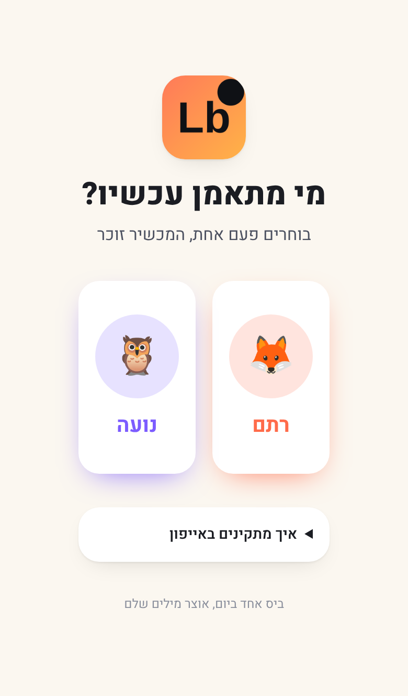
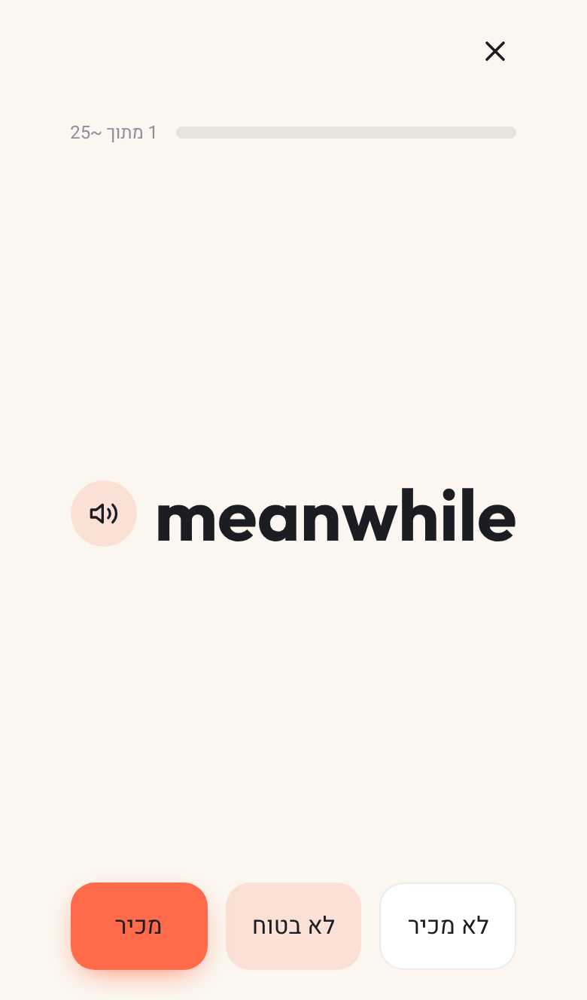
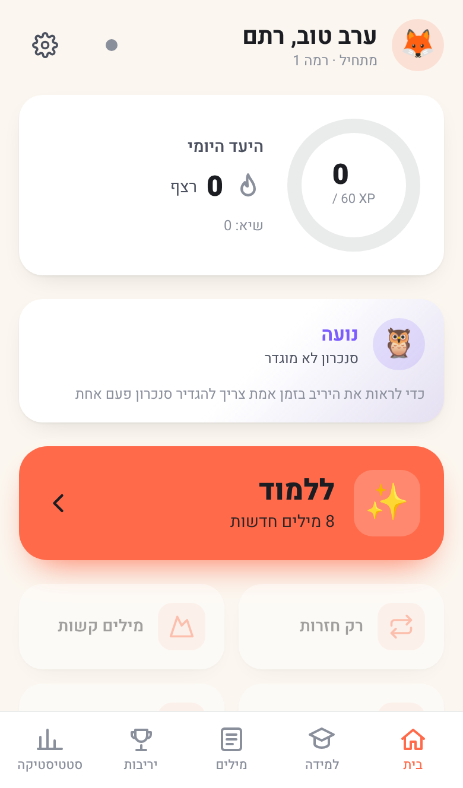
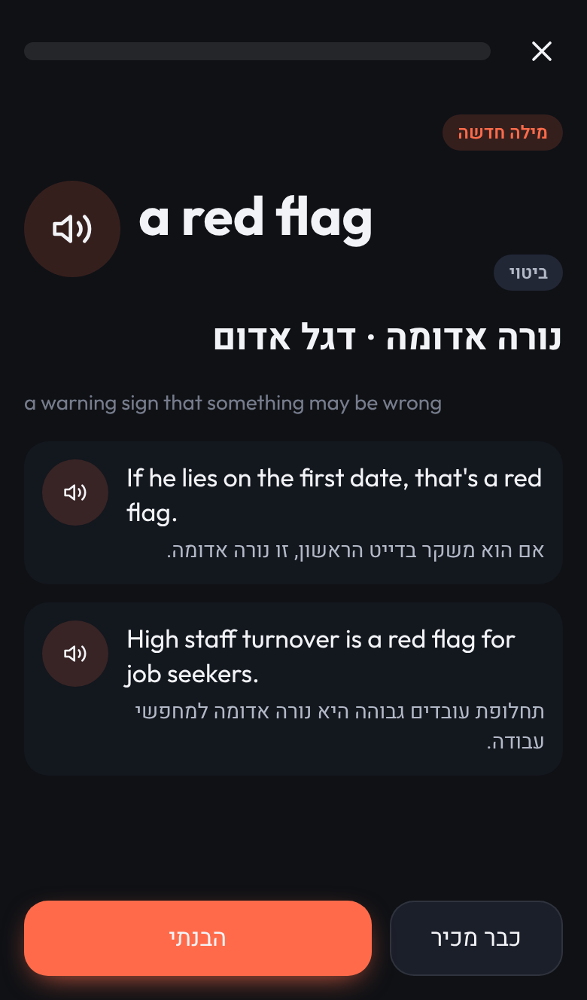
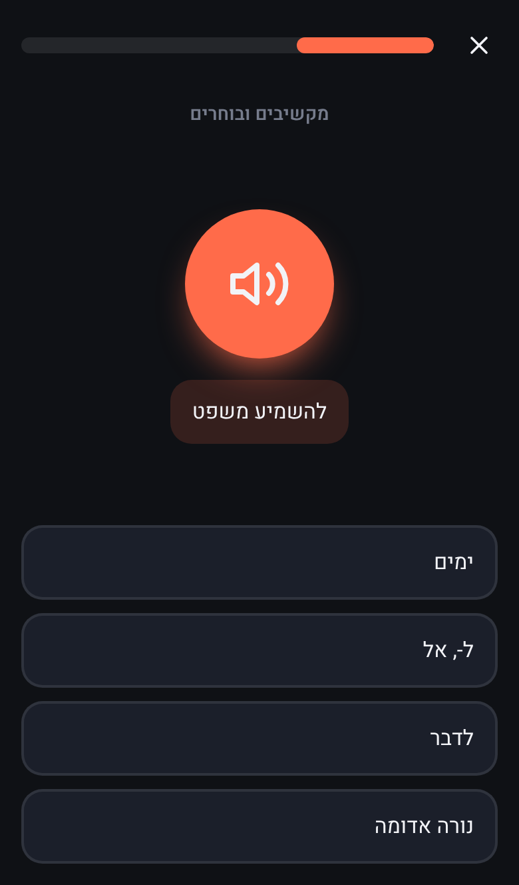
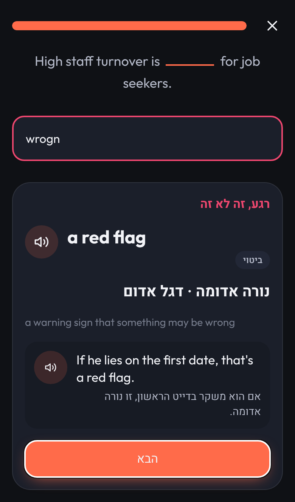
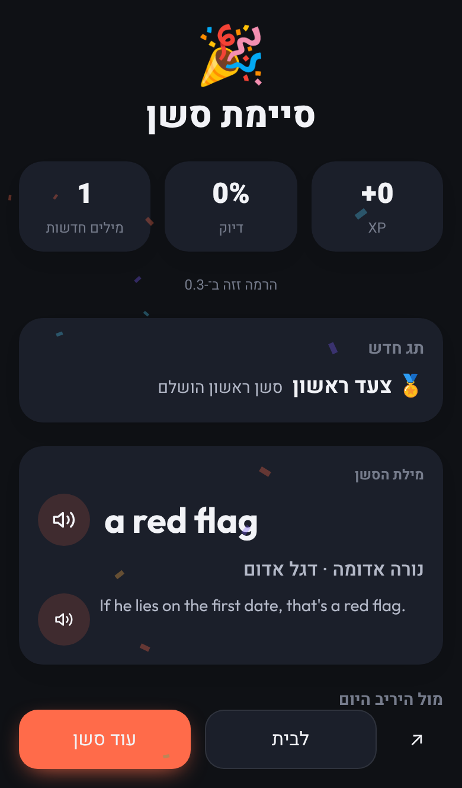
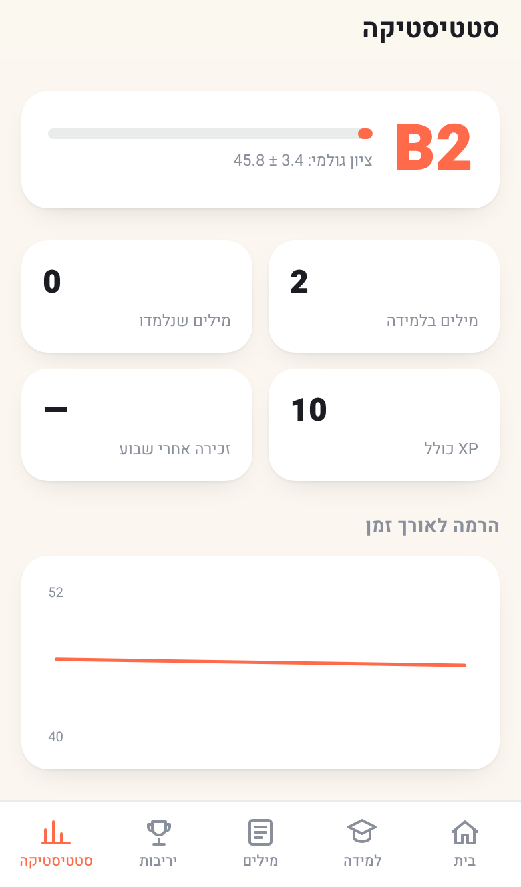
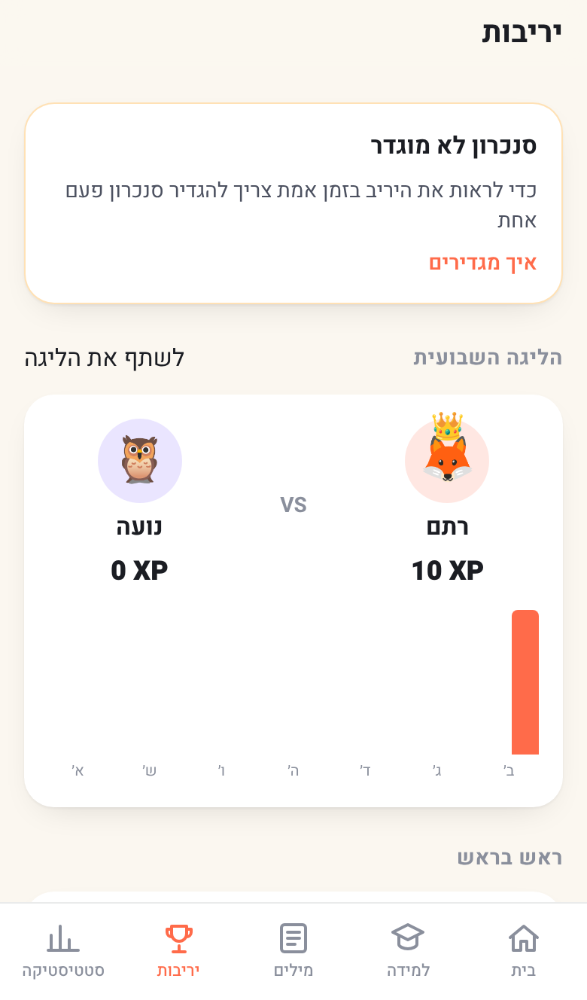

# LexBites

**Live app:** https://rotembenzur.github.io/EnglishApp/

A personal, bite-sized English vocabulary trainer for two people (rotem and noa), built as a
progressive web app that installs on iPhone from Safari. Hebrew RTL interface, English content,
adaptive level, spaced repetition, and a friendly two-player rivalry.

## Install on iPhone

1. Open the live URL above in Safari.
2. Tap the Share button (the square with the arrow).
3. Choose "Add to Home Screen" and confirm.
4. Open LexBites from the home screen. It runs full screen and keeps working offline.

|                                                          |                                                       |                                                                         |
| -------------------------------------------------------- | ----------------------------------------------------- | ----------------------------------------------------------------------- |
|  |  |                              |
|        |     |  |
|          |          |                        |

Screenshots are generated from the running app with `pnpm screenshots` (after `pnpm build` and
`pnpm preview`) and live in `docs/screenshots/`.

> The live URL starts working once the owner finishes step 1 of `SETUP.md` (two settings toggles).

## Run locally

```bash
pnpm install
pnpm dev
```

Other commands:

```bash
pnpm lint            # ESLint
pnpm typecheck       # TypeScript, app and tooling
pnpm test            # Vitest unit tests (engine, content, data)
pnpm test:e2e        # Playwright smoke tests against a production build
pnpm build           # Production build into dist/
pnpm icons           # Regenerate icons and iOS splash screens
pnpm content:validate # Validate authored content against the schema and quality rules
pnpm enrich --from 3001 --to 6000  # Write authoring tasks for missing shards in a rank range
pnpm enrich --check 15          # Validate one shard and report coverage
pnpm enrich --status            # Tier A coverage of the whole inventory
pnpm screenshots                # README screenshots from the running app
```

## Content passes

The word inventory (`content/lemmas.json`) is built by `scripts/build_lemmas.py` from open frequency
data. Tier A content is authored in shards of 200 lemmas (`content/shards/0000.json` and up). See
`docs/ARCHITECTURE.md` for the content pipeline and `SETUP.md` for the few owner actions.

## Project documents

- `STATUS.md`: what is live, what is next, what is waiting on the owner.
- `SETUP.md`: numbered owner actions (GitHub Pages, optional sync backend).
- `CHANGELOG.md`: releases.
- `docs/DECISIONS.md`, `docs/ARCHITECTURE.md`, `docs/SCREENS.md`, `docs/VOICE.md`,
  `docs/QA_CHECKLIST.md`, `docs/BACKLOG.md`.
